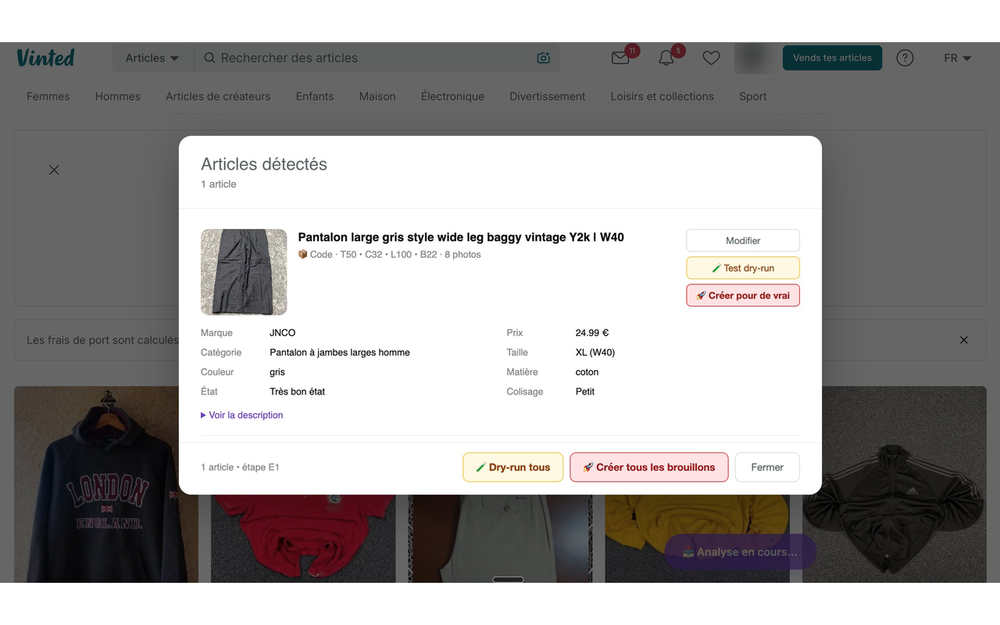
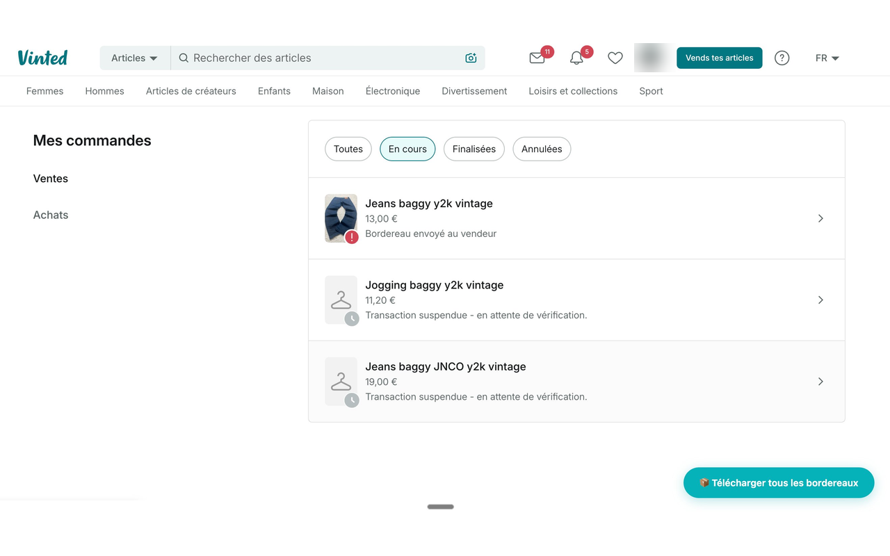
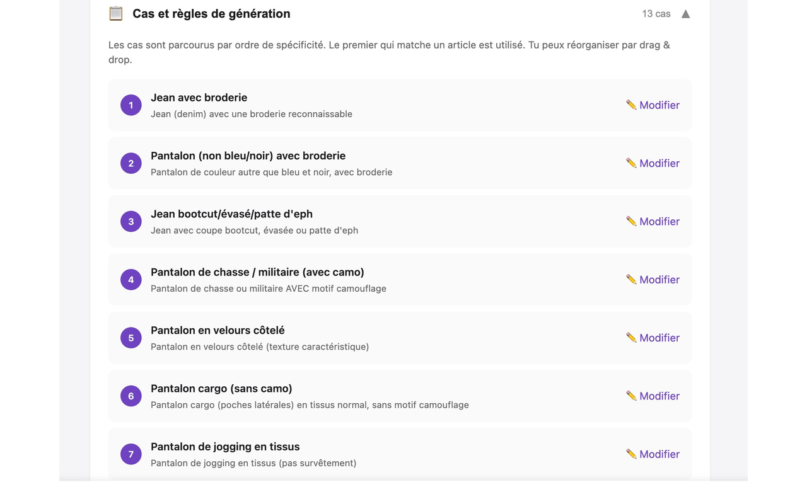

# Saciy — l'assistant des vendeurs Vinted

Saciy est une extension Chrome qui fait gagner des heures aux vendeurs Vinted : elle rédige les annonces à partir des photos, prépare les bordereaux d'expédition, répond aux messages, republie le dressing et suit les ventes dans un CRM.

**Site :** [saciy.dev](https://saciy.dev) · **Version :** 1.21.0

> Ce dépôt est une vitrine. Le code source (extension, API et site) est privé.



---

## Ce que fait Saciy

| Module | Ce qu'il fait pour le vendeur |
|---|---|
| **Annonces IA** | Analyse les photos d'un article et crée le brouillon Vinted complet : titre, description, catégorie, marque, taille, état, couleur, prix. Création par lots possible. |
| **Photos IA** | Retouche et met en valeur les photos (fond, cadrage, portés), avec deux niveaux de qualité. Les photos iPhone (HEIC) sont converties automatiquement. |
| **Expédition** | Récupère tous les bordereaux des commandes en cours, les recadre selon le transporteur et les fusionne en un seul PDF au format thermique 10×15. |
| **Messagerie** | Propose ou envoie des réponses aux acheteurs (questions, négociation, réclamations), et remonte au vendeur les cas délicats. |
| **Scénarios** | Moteur de règles : relance des personnes qui ont mis un article en favori, offres ciblées, réponses types. |
| **Dressing** | Panneau de filtres et de tri du dressing, directement dans Vinted. |
| **Republication** | Republie des articles pour les faire remonter dans les résultats, à un rythme maîtrisé. |
| **CRM** | Suivi des ventes, marges et commandes, alimenté automatiquement depuis le compte Vinted. Multi-comptes. |
| **Sécurité** | Couche transverse qui cadence les actions, surveille les signaux anti-bot et coupe l'automatisation au moindre doute. |

---

## En images

**Tous les bordereaux en un clic**, recadrés et fusionnés pour une imprimante thermique :



**Règles de génération personnalisables** : le vendeur décrit ses cas (type de pièce, coupe, motif) et l'IA applique le bon modèle d'annonce :



---

## Architecture

```
┌────────────────────┐        ┌──────────────────────┐        ┌──────────────────┐
│  Extension Chrome  │  HTTPS │  API Saciy           │        │  IA              │
│  Manifest V3       │ ─────▶ │  FastAPI, Redis,     │ ─────▶ │  Gemini (texte,  │
│  scripts injectés  │        │  PostgreSQL          │        │  vision), modèle │
│  sur vinted.fr     │        │                      │        │  d'images        │
└─────────┬──────────┘        └──────────┬───────────┘        └──────────────────┘
          │  connexion du compte         │  comptes, crédits, abonnement
          ▼                              ▼
┌───────────────────────────────────────────────────────┐
│  Site saciy.dev : Next.js + Supabase (auth, dashboard) │
└───────────────────────────────────────────────────────┘
```

- **Extension** : JavaScript natif, sans framework ni étape de build. Une dizaine de modules indépendants s'injectent sur les pages Vinted et travaillent depuis la session du vendeur. Plus de 2 000 tests unitaires.
- **API** : authentification par clé, quotas et crédits, paiements, proxy vers les modèles d'IA, ingestion des événements du CRM, traitement des photos.
- **Site** : page d'accueil, création de compte, dashboard et CRM côté web.

---

## Stack

- **Extension** : Chrome Manifest V3, JavaScript, pdf-lib, libheif
- **API** : Python, FastAPI, SQLModel + Alembic, PostgreSQL, Redis, Docker
- **IA** : Google Gemini 2.5 Flash (annonces, messages), génération d'images pour les photos
- **Site** : Next.js, React, Tailwind CSS, Supabase
- **Paiement** : Stripe

---

Saciy n'est ni affilié à Vinted, ni approuvé par Vinted.
